# Modèle de données — CIUGB Pitch Battle

## Portée et sources

Ce modèle traduit les exigences du cahier des charges fourni et du `PROMPT_CODEX_CIUGB_PITCH_BATTLE_SPRINTS.md`. Il s'agit d'une proposition de conception pour le Sprint 0, pas d'une migration appliquée. Les valeurs propres au concours qui ne sont pas confirmées restent configurables et ne sont pas seedées avec des données inventées.

Le modèle réduit la duplication : une candidature représente l'inscription d'une équipe et de son projet ; les personnes de l'équipe résident dans `team_members`, avec exactement un membre désigné comme responsable.

## Relations

```mermaid
erDiagram
  contests ||--|| contest_settings : configures
  contests ||--o{ applications : receives
  applications ||--|{ team_members : contains
  applications ||--o{ application_notes : has
  applications ||--o{ status_history : records
  profiles ||--o{ application_notes : writes
  profiles ||--o{ status_history : performs

  contests {
    uuid id PK
    text slug UK
    timestamptz created_at
  }
  contest_settings {
    uuid contest_id PK,FK
    boolean registration_open
    date registration_deadline
    integer min_team_size
    integer max_team_size
    boolean finalists_published
    date event_date
    text venue
    text rules_text
  }
  applications {
    uuid id PK
    uuid contest_id FK
    text reference UK
    text team_name
    text project_title
    text status
    timestamptz consent_at
    timestamptz created_at
    timestamptz updated_at
  }
  team_members {
    uuid id PK
    uuid application_id FK
    text full_name
    boolean is_leader
    text email
    text phone
  }
  profiles {
    uuid id PK,FK
    text role
    timestamptz created_at
  }
  application_notes {
    uuid id PK
    uuid application_id FK
    uuid admin_id FK
    text body
    timestamptz created_at
  }
  status_history {
    uuid id PK
    uuid application_id FK
    uuid admin_id FK
    text from_status
    text to_status
    timestamptz created_at
  }
```

## Tables et contraintes proposées

### `contests`

Représente une édition du Pitch Battle afin que l'unicité des noms d'équipe soit bien définie « par concours » et que les éditions puissent être séparées.

- `id uuid primary key`, généré par la base.
- `slug text not null unique`, identifiant technique choisi par l'organisateur, sans préremplir une date officielle.
- `created_at timestamptz not null default now()`.

### `contest_settings`

Une ligne par édition (`contest_id` est à la fois PK et FK). Cette table porte les réglages éditoriaux et opérationnels déjà listés dans le cahier.

- `registration_open boolean not null default false` : fermé par défaut, en attente d'activation explicite.
- `registration_deadline date null`, `min_team_size integer null`, `max_team_size integer null` : tant que les limites ne sont pas renseignées et cohérentes, la fonction de soumission refuse les candidatures.
- `finalists_published boolean not null default false` : publication fermée par défaut.
- `event_date date null`, `venue text null`, `rules_text text null` : configurables ; une valeur absente ne doit pas être remplacée par une affirmation inventée.
- `privacy_notice_version text null` : version de la notice présentée au candidat.
- `retention_days integer null` : durée à confirmer avant mise en production ; elle ne doit pas être devinée.
- `updated_at timestamptz not null default now()`, `updated_by uuid null references profiles(id)`.

Les paramètres publics ne sont pas exposés directement en bloc. Une fonction ou une vue dédiée ne renvoie que les champs éditoriaux nécessaires.

### `applications`

Le dossier regroupe l'identité de l'équipe, le contenu du projet, le statut privé et les éléments de consentement.

- `id uuid primary key`.
- `contest_id uuid not null references contests(id)`.
- `reference text not null unique` : identifiant aléatoire non séquentiel, généré côté serveur ; jamais dérivé de l'UUID ou d'un compteur visible.
- `team_name text not null`, `project_title text not null`, `summary text not null`, `problem text not null`, `solution text not null`, `category text null`.
- `status application_status not null default 'submitted'`, enum limité à `submitted`, `under_review`, `shortlisted`, `selected`, `rejected`.
- `rules_accepted_at timestamptz not null`, `rules_version text not null`, `privacy_notice_version text not null` : preuve de la version acceptée/présentée au moment du dépôt.
- `created_at timestamptz not null default now()`, `updated_at timestamptz not null default now()`.
- Unicité du nom par concours : index unique sur `(contest_id, lower(btrim(team_name)))`.
- Index supplémentaires : `(contest_id, status, created_at desc)` pour la liste admin et `(contest_id, created_at desc)` pour le tri/pagination.
- Contrôles `CHECK` : chaînes non vides après trim, limites de longueur pour les champs de texte, valeurs de statut valides. La limite de résumé est réglée/configurée selon le cahier (exemple 1000 caractères à confirmer par le comité).

Les informations de contact du responsable sont portées par la ligne correspondante de `team_members`, plutôt que dupliquées ici.

### `team_members`

Chaque membre, responsable inclus, est stocké une seule fois.

- `id uuid primary key`, `application_id uuid not null references applications(id) on delete cascade`.
- `full_name text not null`, `is_leader boolean not null default false`.
- `email text null`, `phone text null` : obligatoires et validés pour le responsable ; les autres membres n'ont pas besoin de coordonnées sauf décision ultérieure.
- `team_role text null`, `institution text null` (inclut établissement/filière facultatifs selon le formulaire).
- Index unique partiel `(application_id) where is_leader` : empêche deux responsables ; l'opération atomique de soumission vérifie qu'il y en a exactement un.
- Index `(application_id)` pour charger les membres d'un dossier.
- `created_at timestamptz not null default now()`.

Le formulaire doit toujours représenter le responsable dans la liste de membres, clairement marqué. La soumission vérifie aussi le nombre total de membres contre les paramètres de l'édition.

### `profiles`

Associe un compte Supabase Auth à un rôle administratif. `id uuid primary key references auth.users(id) on delete cascade`, `role app_role not null default 'admin'`, `created_at timestamptz not null default now()`. Pour le MVP, l'enum ne contient que `admin`.

La création du premier profil admin est une opération d'exploitation contrôlée, jamais une inscription publique. Aucun utilisateur ne peut créer/modifier son rôle depuis le client.

### `application_notes`

Notes exclusivement internes : `id uuid primary key`, `application_id uuid not null references applications(id) on delete cascade`, `admin_id uuid not null references profiles(id)`, `body text not null`, `created_at timestamptz not null default now()`. Les notes sont ajoutées, non modifiées par les candidats et non exposées dans la projection publique.

### `status_history`

Historique append-only des décisions : `id uuid primary key`, `application_id uuid not null references applications(id) on delete cascade`, `admin_id uuid null references profiles(id)`, `from_status application_status null`, `to_status application_status not null`, `created_at timestamptz not null default now()`.

`admin_id` est nul uniquement pour l'événement initial créé automatiquement à la soumission (`null → submitted`). Les changements ultérieurs doivent enregistrer l'admin authentifié. La mutation du statut et l'ajout de l'événement d'historique se font dans une même transaction ; les clients n'écrivent pas directement dans cette table.

## Contrat de soumission atomique

L'Edge Function `submit-application` reçoit les champs du formulaire et :

1. Valide la forme, les limites de taille, l'acceptation règlement/confidentialité et les champs obligatoires côté serveur.
2. Vérifie que l'édition existe, que les inscriptions sont ouvertes, que la date limite n'est pas dépassée et que les min/max configurés sont cohérents.
3. Applique le contrôle anti-spam/rate limit et vérifie le doublon selon les règles de concours. L'index unique du nom d'équipe est l'arbitre final des collisions concurrentes.
4. Appelle une opération DB contrôlée qui, dans une transaction, crée l'application, tous les membres dont exactement un responsable, l'événement initial, puis retourne uniquement la référence publique.
5. Renvoie un message d'erreur non bavard en cas d'échec ; aucun dossier partiel ne subsiste.

Le détail d'implémentation (RPC `SECURITY DEFINER` à privilèges minimaux ou appel serveur contrôlé) devra être choisi en préparant les migrations. Si `SECURITY DEFINER` est retenu, fixer `search_path`, réduire les grants et tester explicitement les permissions. Aucun secret `service_role` n'est livré dans Angular.

## Accès et RLS

RLS est activé sur toutes les tables exposées par l'API, avec refus par défaut.

| Ressource | Anonyme | Candidat | Admin authentifié |
|---|---|---|---|
| `contests` / `contest_settings` | Aucun accès direct ; lecture des seuls champs publics via projection dédiée | Idem | Lecture et édition des paramètres autorisées |
| `applications` | Aucun `SELECT`, `INSERT`, `UPDATE`, `DELETE` direct | Aucun accès direct après dépôt ; la référence retournée ne donne pas accès au dossier | Lecture ; changements de statut via opération autorisée |
| `team_members` | Aucun accès direct | Aucun accès direct | Lecture via fiche candidature |
| `profiles` | Aucun accès | Aucun accès ou lecture strictement limitée au profil courant | Vérification de rôle selon politique dédiée ; aucun auto-attribution |
| `application_notes` | Aucun accès | Aucun accès | Lecture et ajout |
| `status_history` | Aucun accès | Aucun accès | Lecture ; insertion via la transaction de changement de statut |
| Projection des finalistes | Lecture des seuls champs publics, uniquement si `selected` et `finalists_published` | Idem | Lecture complète via les tables protégées |

Une fonction helper de vérification admin doit éviter la récursion RLS et ne pas permettre à un client de s'octroyer le rôle. Les guards Angular améliorent l'expérience, mais ne constituent pas le contrôle d'accès.

## Projection publique des finalistes

La page `/finalistes` consomme une vue/RPC dédiée qui joint les candidatures à `contest_settings` et ne renvoie que `team_name`, `project_title`, `summary` et éventuellement `category`. Elle filtre simultanément sur `status = 'selected'` et `finalists_published = true`. Aucun identifiant interne, référence de candidature, contact, membre, note ou historique n'est exposé. La publication globale désactivée masque toute la liste, même si des dossiers sont sélectionnés.

## Décisions encore requises

- Taille minimale/maximale des équipes et traitement des cas où le responsable ne serait pas membre (modèle proposé : il est inclus).
- Seuil exact du résumé et autres limites de longueur ; catégorie libre ou référentiel fixe.
- Règle anti-doublon email/téléphone et possibilité de resoumettre après rejet.
- Durée de conservation et procédure d'effacement/anonymisation après l'événement.
- Version et texte du règlement et de la notice de confidentialité.
- Workflow des transitions de statut autorisées et gestion d'une annulation/erreur de décision.
- Informations publiques complémentaires souhaitées pour les finalistes.

## Hors de cette proposition

Aucune migration SQL n'est appliquée, aucun compte admin n'est créé, aucune donnée candidate n'est seedée, et aucune politique RLS n'est présentée comme déjà déployée. Les migrations ne démarreront qu'après validation du schéma et des règles métier qui conditionnent les contraintes.
